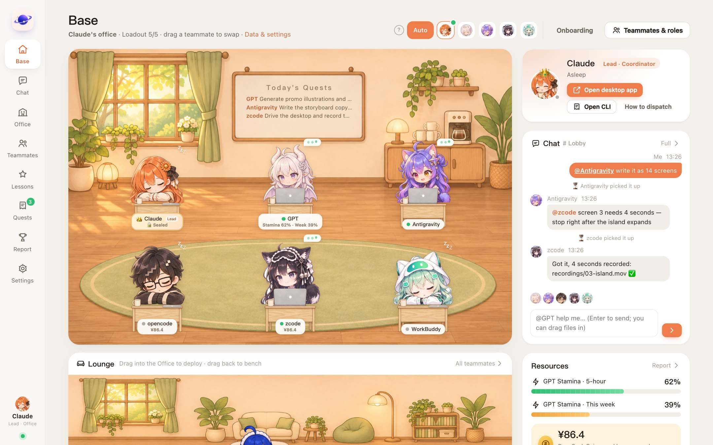
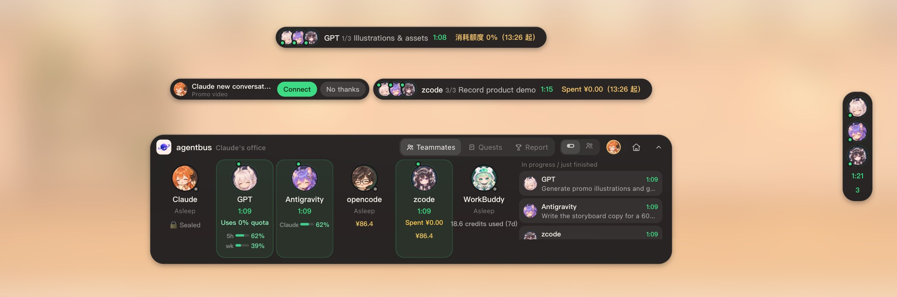
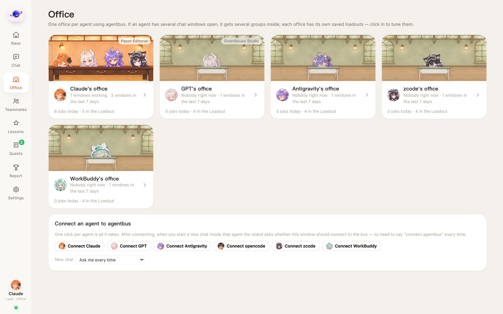
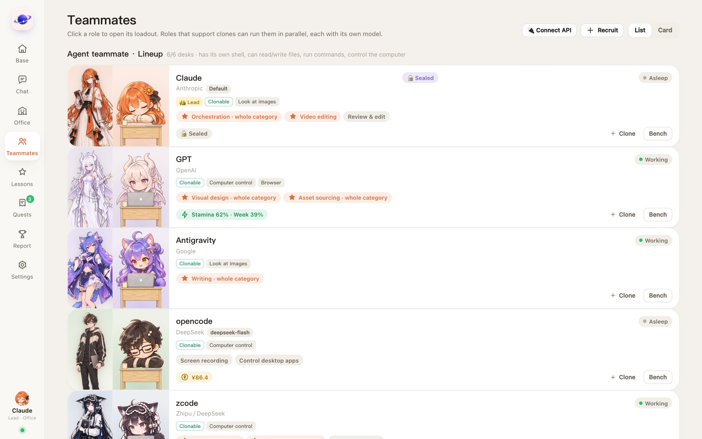
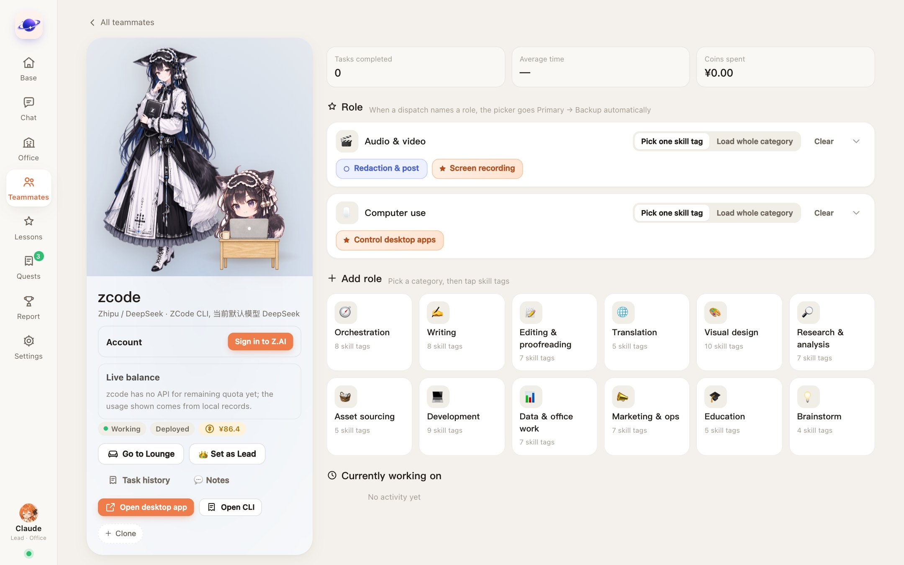
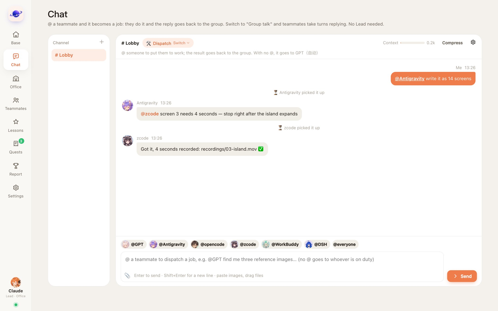
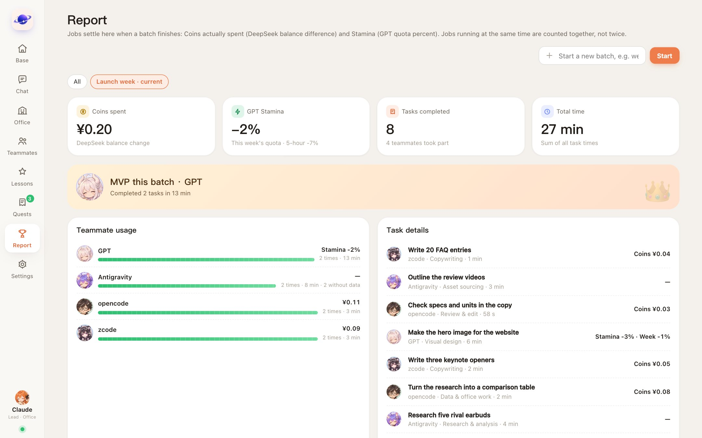
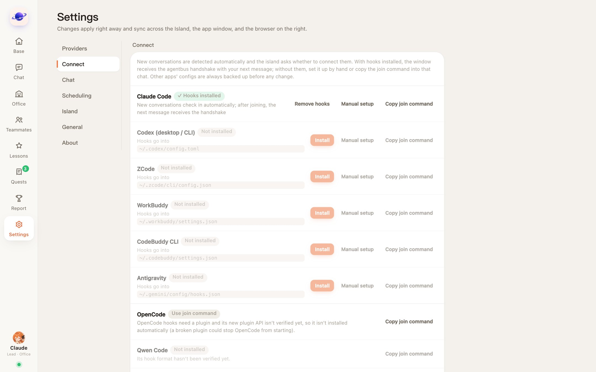

<p align="center"></p>

<h1 align="center">agentbus</h1>

<p align="center"><b>Stop being the messenger between your AI windows.</b><br>
agentbus turns the agents already on your computer — Claude Code, Codex, Antigravity, ZCode, OpenCode, WorkBuddy, any OpenAI-compatible API — into one team that works together. One <b>lead</b> plans, teammates work in parallel with their own local abilities, finished jobs report back automatically, and every job is billed against your real quota.</p>

<p align="center"><b>English</b> · <a href="README.zh-CN.md">中文</a></p>

<p align="center"><a href="#install">Download</a> · <a href="#quick-start">Quick start</a> · <a href="#screenshots">Screenshots</a> · <a href="#how-is-this-different">Comparison</a></p>

<p align="center"></p>

## The problem

You probably have several AI agents installed, and each is good at something different. One plans well, one makes images, one can drive your desktop and record the screen. But they don't know each other:

- **You are the copy-paste bus.** Copy the plan from one window, paste it into another, switch, wait, copy the result back.
- **You can't see who is doing what.** Is that job done? Stuck? You check each window by hand.
- **Nobody reports back.** A job finishes in the background and the agent that asked for it never hears about it.
- **Spending is a blur.** How much of your 5-hour / weekly quota did this batch use? Did it start burning paid credits?

agentbus is a local office layer. You keep talking to the agent you already use; it becomes the **lead**, hands jobs to the rest of the team, and progress, results and costs all land in one place.

## What it does

### Join from any conversation
Send the first message in any agent's window and the floating island asks **"Join the bus?"**. Click once and that window becomes the lead — no plugin to install, no config to edit. Agents with hooks (Claude Code, Codex, ZCode, WorkBuddy, Antigravity) are set up with one click; for anything else agentbus gives you a one-line join phrase.

### One sentence, many agents at once
Ask the lead for something like *"make a 60-second product video"*. It splits the work and dispatches it: GPT generates and gathers assets, Antigravity writes the copy, ZCode drives the desktop and records a demo — at the same time, each using its own **local abilities** (files, browser, screen recording, image generation, shell). When they finish, results come back to the lead automatically to be put together.

### Roles, not names
Give each teammate roles — coordination, copywriting, screen recording, video editing, asset gathering… — as **primary** or **backup**. Dispatch by role and agentbus picks the right teammate; one teammate can be cloned to take two jobs in parallel.

### The floating island
A Dynamic-Island-style capsule at the edge of your screen:
- collapsed, it shows who is working and for how long;
- hover or click to expand: each teammate's state and **remaining quota**;
- drag it to any edge and it docks there (top, bottom, left, right, or floating);
- it pops a card when a job finishes, and asks to connect when you open a new agent conversation.

### An office that feels alive
Every teammate is a chibi character at a desk in a cozy pixel office. They doze when idle and get to work when a job starts. Each lead has its **own office**, with the conversations it ran grouped by project.

### Chat room relay
`@teammate` in a channel dispatches a job; a teammate whose reply `@`s someone else hands the work on — no need for you to pass messages along. Group-talk mode lets teammates discuss in turns, and long history is compressed into notes automatically.

### Billing and safety rails
Time, subscription quota and money are recorded for every job. When a subscription quota runs out, agentbus stops instead of quietly spending paid credits. A watchdog restarts a teammate that has gone quiet. Claude is **sealed** by default (never dispatched, never billed) and can be unsealed in its teammate page.

## Screenshots

| | |
|---|---|
|  |  |
| **Floating island** — collapsed capsule, "join the bus?" prompt, expanded panel with remaining quota, and side docking | **Offices** — every lead has its own office; conversations are grouped by project |
|  |  |
| **Teammates** — portraits, brains (models), roles and quota at a glance | **Roles** — equip roles by category, primary or backup |
|  |  |
| **Chat room** — `@` a teammate to dispatch; teammates relay work to each other | **Report** — real cost per batch: coins, stamina, time, MVP |
|  | |
| **Connect** — one-click hooks, manual setup, or a join phrase for any agent | |

## Supported agents

| Agent | How jobs run | Quota / cost |
|---|---|---|
| Claude Code | Lead; sealed as a teammate by default (unseal in its page) | Local token usage |
| Codex CLI (GPT) | `codex exec` | 5-hour / weekly subscription quota |
| Antigravity | `agy -p` | Per-model quota read from the Antigravity app |
| OpenCode, ZCode, DeepSeek Harness | CLI | DeepSeek balance |
| WorkBuddy / CodeBuddy | CLI | Local credit usage |
| Qwen Code, Kimi CLI, Cursor Agent | CLI | Time only |
| Any OpenAI-compatible API (DeepSeek, GLM, Kimi, Qwen, OpenRouter…) | Built-in API teammate that can read and write project files | Balance, where the provider has a balance API |

Missing ones can be installed from the Lounge with **Recruit** (Antigravity opens its official download page).

## How is this different

Good open-source projects already cover parts of this. agentbus does not try to replace them:

| Approach | Examples | What they do well | What agentbus adds |
|---|---|---|---|
| Several agents in parallel git worktrees | Claude Squad, Crystal, Vibe Kanban | Parallel coding in one repo, diff review | Not just code: copy, images, screen recordings, research. Jobs are routed by **role** |
| The main agent calls other models over MCP | PAL MCP, Roundtable | A second opinion mid-task | A dispatch is a real **job**: queued, concurrency-limited, restarted when stalled, and it **reports back to the lead**. Any MCP-capable agent can lead |
| Pixel-art office that shows agent status | Pixel Agents, claude-office | Delightful visibility | The office *is* the dispatcher, plus the floating island |
| @-mention several models in one chat | Fixy Code | Compare answers | `@teammate` **dispatches a job**; replies hand work on |
| Token usage reports | ccusage | After-the-fact totals | Billing **per job** across subscription quota and pay-as-you-go balance, with a hard stop before paid credits |

In short: most tools solve one step. agentbus wires join → dispatch → progress → report back → billing into one loop, across the agents you already use.

## Install

Download the installer for your platform from [Releases](../../releases):

| Platform | File |
|---|---|
| macOS (Apple silicon / Intel) | `.dmg` |
| Windows 10/11 | `.exe` installer (per-user, no admin needed) |
| Linux | `.deb` or `.AppImage` |

> The macOS build is not signed yet. On first launch, right-click agentbus in Finder → Open, or run
> `xattr -dr com.apple.quarantine /Applications/agentbus.app`

**Run from source** (Python 3.9+, no extra dependencies):

```bash
git clone https://github.com/baitongren166-hub/agentbus.git ~/agentbus
python3 ~/agentbus/core/service.py                        # local service, UI at http://127.0.0.1:8790
ln -s ~/agentbus/core/agentbus.py ~/.local/bin/agentbus   # CLI (optional)
```

The desktop app (island, menu bar) is built with Tauri: `cd app && npm ci && npx tauri build`.

## Quick start

1. Open agentbus. On first launch it looks at which agents you have, sets up a lineup and starts a short tour.
2. Open a conversation in any agent you use and send a message — the island asks whether to join. Click **Connect**.
   (Or register the MCP server once: `claude mcp add --scope user agentbus -- python3 ~/agentbus/core/mcp_server.py`.)
3. Talk to your lead in plain language:
   - "Who's in the office and how much quota is left?"
   - "At the same time: have GPT make three illustrations and Antigravity write the copy. Tell me when both are done."
   - "How much quota and money did this batch use?"

Or from the command line:

```bash
agentbus ask opencode "Turn the meeting notes in docs/ into a table" --tag research
agentbus ask "screen recording" "Record a 30-second demo of the settings page"   # a role: picks by preference
agentbus wait                                                                    # wait for your jobs
agentbus bill                                                                    # real cost of this batch
```

## Data and privacy

- Everything runs locally and lives in `~/.agentbus/` (override with `AGENTBUS_HOME`). No cloud, no telemetry; the only network call is the optional update check against GitHub Releases.
- API keys go to the macOS Keychain, Windows DPAPI, or a user-only file on Linux; the UI and logs only show fingerprints. A key agentbus discovers can only be sent to the host it was configured for.
- The service listens on `127.0.0.1` only, rejects cross-site browser requests, and only accepts changes from processes of the same system user.
- Installing hooks backs up the other agent's config first and only touches agentbus's own entries; uninstalling restores what was there.

## Layout

| Path | What |
|---|---|
| `core/service.py` | Local service (127.0.0.1:8790): data for the UI, SSE push |
| `core/agentbus.py` | CLI: dispatch, wait, billing, hooks |
| `core/mcp_server.py` | MCP server (`agentbus_*` tools) |
| `core/connectors.py` | How each agent connects (hooks, manual setup, join phrase) |
| `core/activity.py` | Reads each agent's session logs to see what it is doing |
| `core/chat.py`, `core/quota.py`, `core/playbook.py` | Chat room, quota readings, playbooks |
| `core/pf.py` | macOS / Windows / Linux differences |
| `ui/` | Main window and island; `ui/i18n/` holds the English dictionary |
| `app/` | Tauri desktop shell |

## Translating

UI strings are written in Chinese in the source and translated at runtime. After changing UI text, run `python3 scripts/i18n-extract.py`, translate the entries in `ui/i18n/missing.json` into `ui/i18n/extra.en.json`, then `python3 scripts/i18n-build.py`.

## Contributing

Issues and PRs are welcome. For UI changes, please check light and dark themes and both top and side docking of the island; for backend changes, run one real dispatch.

## License

[MIT](LICENSE)
