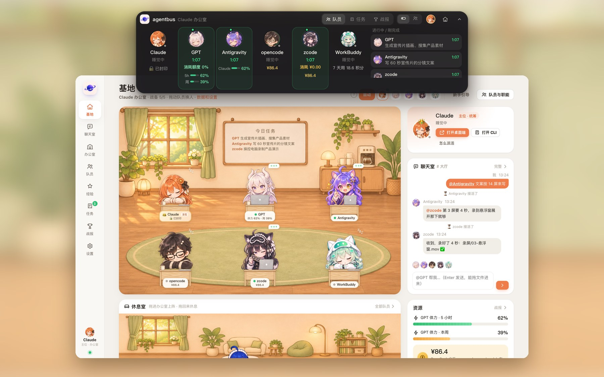
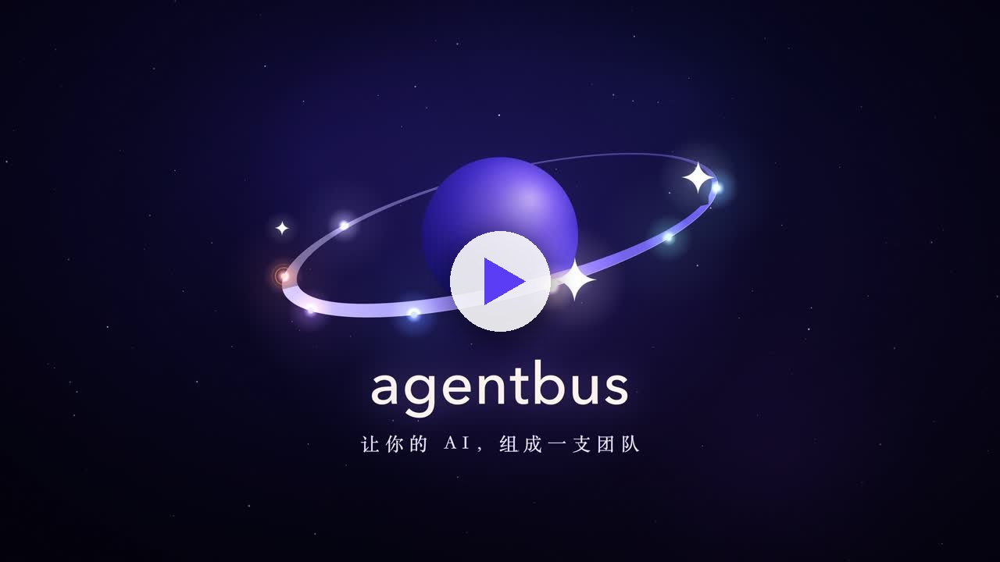
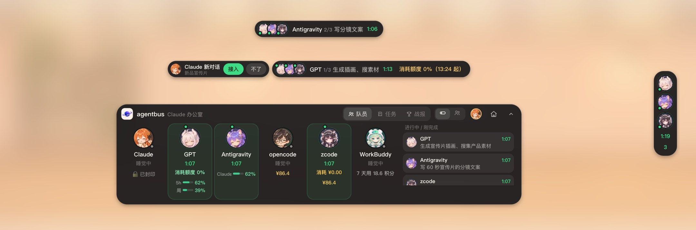
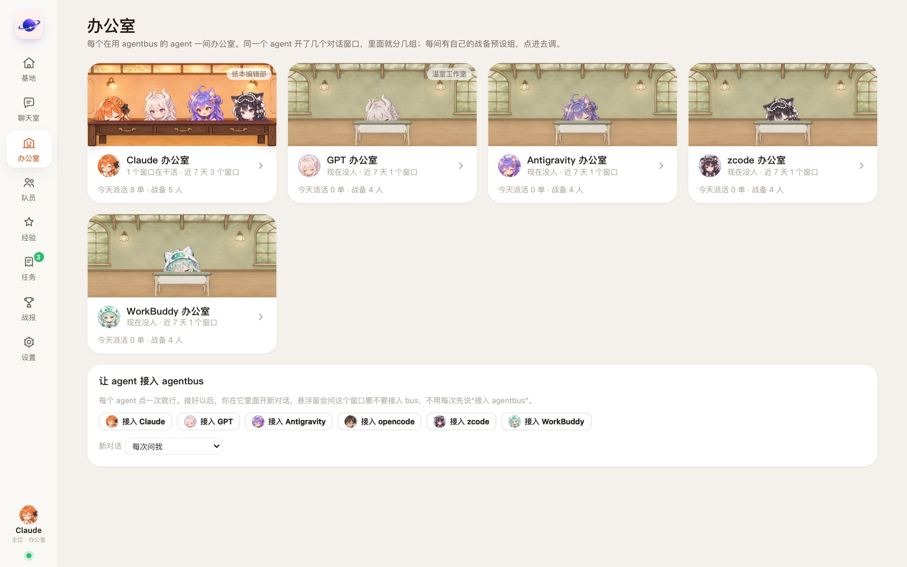
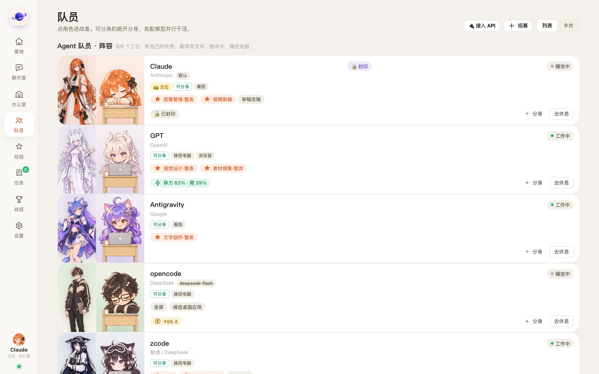
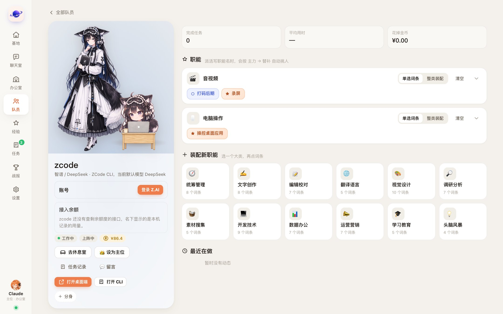
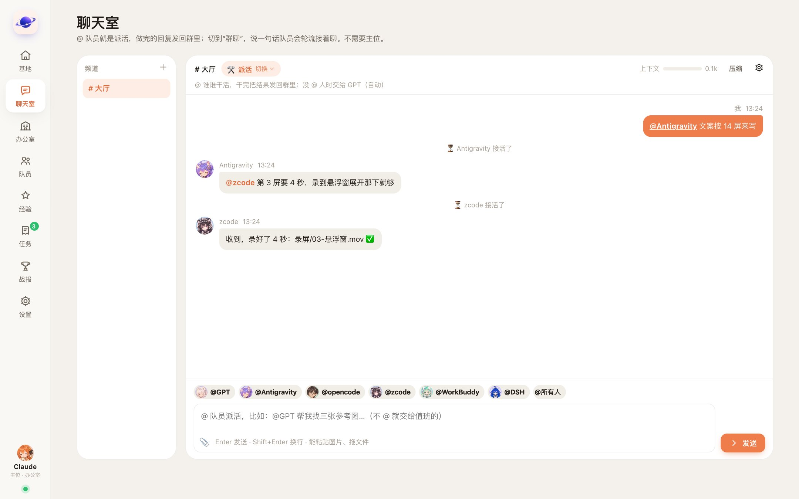
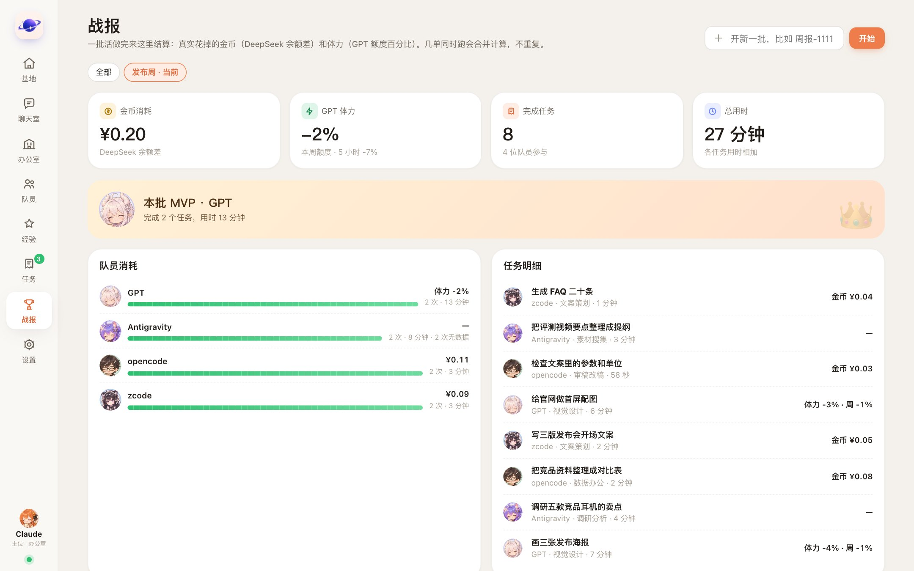
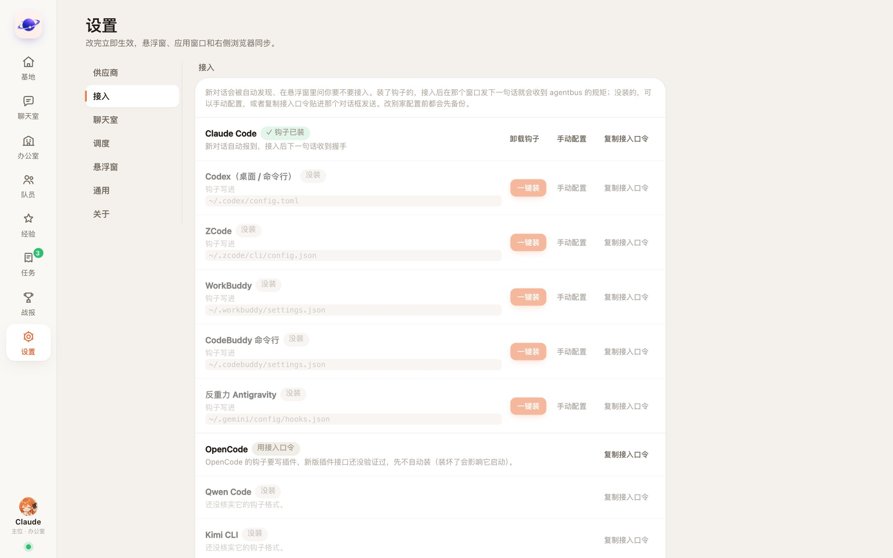

<p align="center"></p>

<h1 align="center">agentbus</h1>

<p align="center"><b>别再在多个 AI 窗口之间当传话筒。</b><br>
agentbus 把你电脑上已经装好的 agent —— Codex、Antigravity、ZCode、OpenCode、WorkBuddy，以及任何兼容 OpenAI 的 API —— 组成一支会协作的队伍：一位<b>主位</b>统筹，队员用各自的本地能力同时开工，做完自动回报，每一单都按你真实的额度记账。</p>

<p align="center"><a href="README.md">English</a> · <b>中文</b></p>

<p align="center"><a href="#安装">下载</a> · <a href="#视频">视频</a> · <a href="#快速上手">快速上手</a> · <a href="#截图">截图</a> · <a href="#和已有项目有什么不同">对比</a></p>

<p align="center"></p>

## 视频

<table><tr>
<td align="center" width="33%"><a href="https://github.com/baitongren166-hub/agentbus/releases/download/v0.6.0/agentbus-concept.mp4"></a><br><b>概念片</b><br><sub>如果，它们本该是一支团队？· 1:32</sub></td>
<td align="center" width="33%"><a href="https://github.com/baitongren166-hub/agentbus/releases/download/v0.6.0/agentbus-launch.mp4"></a><br><b>产品发布视频</b><br><sub>各有所长，组成一支队伍 · 0:58</sub></td>
<td align="center" width="33%"><a href="https://github.com/baitongren166-hub/agentbus/releases/download/v0.6.0/agentbus-demo.mp4"></a><br><b>操作演示</b><br><sub>真实界面，一步步来 · 1:48</sub></td>
</tr></table>

<p align="center"><sub>点封面下载观看。</sub></p>

## 痛点

你可能装了好几个 AI agent，各有所长：有的擅长统筹，有的会生图，有的能操控电脑、录屏。可它们彼此并不认识：

- **你成了传话筒**：从一个窗口复制方案，粘到另一个窗口，切过去，等着，再把结果复制回来。
- **看不见谁在干什么**：那单做完了吗？卡住了吗？只能一个个窗口去翻。
- **没人回报**：后台的活做完了，派活的那个 agent 根本不知道。
- **花了多少说不清**：这一批用掉多少 5 小时 / 每周额度？是不是悄悄开始扣付费 credits 了？

agentbus 是装在本机的一层"办公室"。你照常和手边的 agent 说话，它就是**主位**，把活分给队员；进度、结果、花费都汇到一处。

## 能做什么

### 任意对话，一点接入
在任何一个 agent 的对话框里发出第一句话，悬浮窗就会问：**"接入 bus？"**。点一下，这个窗口就成了主位，不装插件、不改配置。支持钩子的 agent（Claude Code、Codex、ZCode、WorkBuddy、Antigravity）一键装好；其他 agent 也有一句接入口令兜底。

### 一句话，多位队员同时开工
对主位说"做一支 60 秒的产品宣传片"，它会拆开分下去：GPT 生成和搜集素材，Antigravity 写文案，ZCode 操控电脑录演示，几位同时开工，各用各的**本地能力**（读写文件、浏览器、录屏、生图、跑命令）。做完自动回报给主位汇总。

### 按岗位派活
给队员装配职能：统筹、文案、录屏、剪辑、素材搜集……分主力和替补。按岗位派活，agentbus 自动挑人；同一位队员还能开分身，同时接两单。

### 悬浮窗
停在屏幕边上的一颗"灵动岛"胶囊：
- 收起时，显示谁在干活、干了多久；
- 碰一下展开：每位队员的状态和**剩余额度**；
- 拖到哪条边就停靠在哪（上、下、左、右，或者自由悬浮）；
- 活干完弹出完成卡片；新开 agent 对话时问你要不要接入。

### 会动的办公室
每位队员是一个 Q 版小人，坐在温馨的像素办公室里：空闲时打盹，接到活就开工。每位主位都有**自己的办公室**，接过的对话按项目归类。

### 聊天室接力
在频道里 `@队员` 就是派活；队员回复里再 `@` 别人，活就接力下去，不用你转述。群聊模式下队员轮流讨论，聊长了自动压缩成要点。

### 记账和安全护栏
每一单都记下用时、订阅额度和花费。订阅额度见底就停下，不会悄悄扣付费 credits。队员长时间没动静，看门狗会开新会话重试。Claude 在 AgentBus 中永久封印。

## 截图

| | |
|---|---|
|  |  |
| **悬浮窗**：收起的胶囊、"接入 bus？"询问、展开的额度面板、侧边停靠 | **办公室**：每位主位一间，对话按项目归类 |
|  |  |
| **队员**：立绘、大脑（模型）、职能、额度一目了然 | **职能**：按大类装配，分主力和替补 |
|  |  |
| **聊天室**：`@` 队员就是派活，队员之间互相接力 | **战报**：每批活的真实花费：金币、体力、用时、MVP |
|  | |
| **接入方式**：一键装钩子、手动配置，或复制一句接入口令 | |

## 支持的 agent

| agent | 怎么派活 | 额度 / 花费 |
|---|---|---|
| Claude Code | 在 AgentBus 中永久封印 | — |
| Codex CLI（GPT） | `codex exec` | 5 小时 / 每周订阅额度 |
| Antigravity | `agy -p` | 从 Antigravity 应用读每个模型的额度 |
| OpenCode、ZCode、DeepSeek Harness | 命令行 | DeepSeek 余额 |
| WorkBuddy / CodeBuddy | 命令行 | 本机积分用量 |
| Qwen Code、Kimi CLI、Cursor Agent | 命令行 | 只记用时 |
| 任何兼容 OpenAI 的 API（DeepSeek、GLM、Kimi、Qwen、OpenRouter……） | 内置 API 队员，能读写项目文件 | 有余额接口的服务商显示余额 |

没装的可以在休息室点**招募**一键安装（Antigravity 会打开官方下载页）。

## 和已有项目有什么不同

已经有不少好的开源项目覆盖了其中一部分，agentbus 不打算替代它们：

| 思路 | 代表项目 | 它们擅长 | agentbus 多做了什么 |
|---|---|---|---|
| 多个 agent 在 git worktree 里并行 | Claude Squad、Crystal、Vibe Kanban | 同一个仓库里并行写代码、审 diff | 不只写代码：文案、图片、录屏、调研；按**岗位**派活 |
| 主 agent 通过 MCP 调其他模型 | PAL MCP、Roundtable | 干到一半问问别的模型 | 派出去的是真正的**任务**：排队、限并发、卡住重启，做完**回报主位**；任何支持 MCP 的 agent 都能当主位 |
| 像素办公室显示 agent 状态 | Pixel Agents、claude-office | 看得见、很可爱 | 办公室**就是**调度台，再加上悬浮窗 |
| 一个对话里 @ 多个模型 | Fixy Code | 对比回答 | `@队员` 就是**派活**，回复里 @ 别人就接力 |
| token 用量统计 | ccusage | 事后看总数 | **按单**记账，订阅额度和按量余额都算；额度见底前硬性拦住 |

一句话：别的工具大多解决其中一环；agentbus 把 接入 → 派活 → 进度 → 回报 → 记账 串成一个闭环，用的就是你已经装好的这些 agent。

## 安装

到 [Releases](../../releases) 下载对应平台的安装包：

| 平台 | 文件 |
|---|---|
| macOS（Apple 芯片 / Intel） | `.dmg` |
| Windows 10/11 | `.exe` 安装程序（装在当前用户下，不需要管理员权限） |
| Linux | `.deb` 或 `.AppImage` |

> macOS 版暂时没有签名。第一次打开时在访达里右键 agentbus → 打开，或者运行
> `xattr -dr com.apple.quarantine /Applications/agentbus.app`

**从源码运行**（Python 3.9+，不需要额外依赖）：

```bash
git clone https://github.com/baitongren166-hub/agentbus.git ~/agentbus
python3 ~/agentbus/core/service.py                        # 本地服务，界面在 http://127.0.0.1:8790
ln -s ~/agentbus/core/agentbus.py ~/.local/bin/agentbus   # 命令行（可选）
```

桌面应用（悬浮窗、菜单栏）用 Tauri 构建：`cd app && npm ci && npx tauri build`。

## 快速上手

1. 打开 agentbus。第一次启动会看看你装了哪些 agent，配好阵容，再走一遍新手引导。
2. 在你常用的 agent 里开个对话、发一句话，悬浮窗会问要不要接入，点 **接入**。
   如需在支持的客户端中手动注册 MCP，服务器名称填 `agentbus`，命令填 `python3`，参数填 `~/agentbus/core/mcp_server.py`。
3. 用大白话跟主位说：
   - "办公室里都有谁？额度还剩多少？"
   - "同时安排：GPT 画三张插画，Antigravity 写文案，两个都做完告诉我。"
   - "这一批花了多少额度和钱？"

或者用命令行：

```bash
agentbus ask opencode "把 docs/ 里的会议记录整理成表格" --tag 调研
agentbus ask 录屏 "录一段 30 秒的设置页演示"   # 写岗位：按偏好挑人
agentbus wait                                 # 等你派出去的活
agentbus bill                                 # 这一批的真实花费
```

## 数据和隐私

- AgentBus 的数据保存在本机 `~/.agentbus/`（可以用 `AGENTBUS_HOME` 改位置），不收集遥测。已配置的队员、余额查询及可选的更新检查会访问各自的服务。启用飞书接入后，飞书聊天中用到的项目名、卡片、消息和附件会发送给飞书。
- API key 存进 macOS 钥匙串、Windows DPAPI 或 Linux 上只有自己能读的文件；界面和日志只显示指纹。agentbus 发现的 key 只能发往它原本配置的那个地址。
- 本地服务只监听 `127.0.0.1`，拒绝网页的跨站请求，改动类请求只接受同一个系统用户的程序。
- 装钩子前先备份别家 agent 的配置，只动 agentbus 自己的那几条；卸载时还原原来的样子。

## 目录

| 路径 | 内容 |
|---|---|
| `core/service.py` | 本地服务（127.0.0.1:8790）：界面数据、SSE 推送 |
| `core/agentbus.py` | 命令行：派活、等结果、记账、钩子 |
| `core/mcp_server.py` | MCP 服务（`agentbus_*` 工具） |
| `core/connectors.py` | 各家 agent 怎么接入（钩子、手动配置、接入口令） |
| `core/activity.py` | 读各家 agent 的会话记录，看它在干什么 |
| `core/chat.py`、`core/quota.py`、`core/playbook.py` | 聊天室、额度读数、经验包 |
| `core/pf.py` | macOS / Windows / Linux 的差异 |
| `ui/` | 主窗口和悬浮窗；`ui/i18n/` 是英文词典 |
| `app/` | Tauri 桌面壳 |

## 翻译

界面文字在源码里用中文写，运行时翻译。改了界面文字后运行 `python3 scripts/i18n-extract.py`，把 `ui/i18n/missing.json` 里列出的条目译好写进 `ui/i18n/extra.en.json`，再运行 `python3 scripts/i18n-build.py`。

## 参与贡献

欢迎提 Issue 和 PR。改界面请检查浅色、深色两套主题，以及悬浮窗的顶部、侧边停靠；改后端请真实派一单试试。

## 许可证

[MIT](LICENSE)
